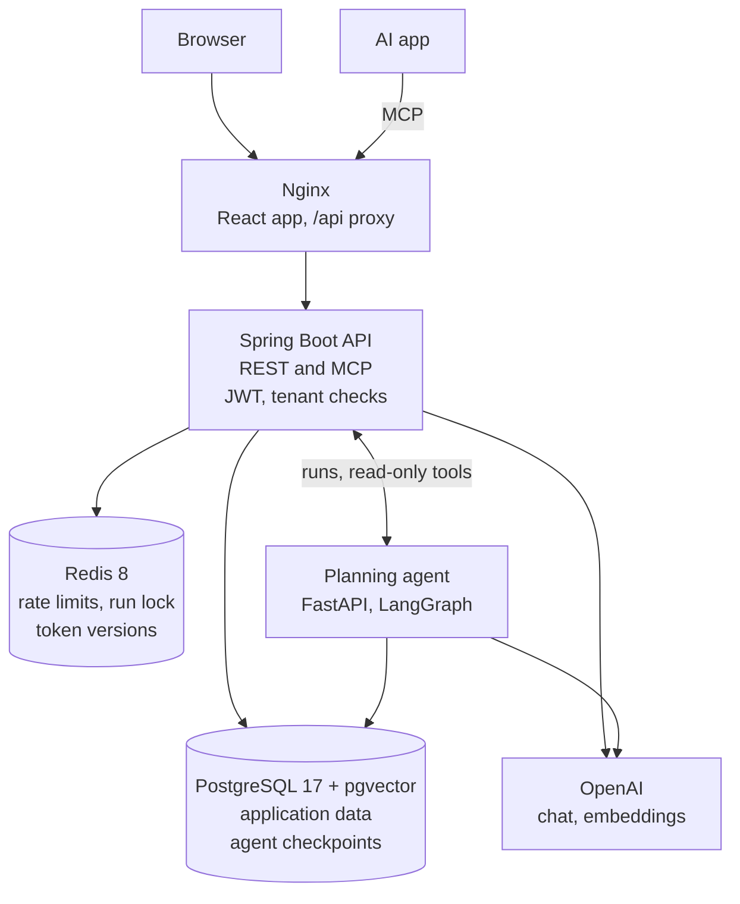

# FlowAI

[](https://github.com/vokyo/FlowAi/actions/workflows/ci.yml)

**Live demo:** [Open FlowAI](https://hospitable-friendship-production-52e2.up.railway.app) · **Agent documentation:** [agent/README.md](./agent/README.md)

FlowAI is a multi-tenant project and issue management application with an AI planning agent. Give it a goal: it searches the project's existing issues and members, proposes a plan that reuses tracked work, and pauses for review. Revise, approve, or cancel the plan; the backend creates issues only after approval.

The application also provides board/list workflows, analytics, reviewable Copilot drafts, and a read-only MCP server for AI apps. Authorization, tenant isolation, validation, and transactional writes stay in the Spring Boot backend. This is a runnable portfolio MVP with automated checks and a live deployment; production operations and an SLA are outside its scope.

## Contents

- [Try the demo](#try-the-demo)
- [Quick start](#quick-start)
- [Features and status](#features-and-status)
- [Architecture and stack](#architecture-and-stack)
- [Planning agent](#planning-agent)
- [AI configuration](#ai-configuration)
- [Connect an AI app over MCP](#connect-an-ai-app-over-mcp)
- [Configuration reference](#configuration-reference)
- [API overview](#api-overview)
- [Verification](#verification)
- [Deployment and operations](#deployment-and-operations)
- [Demo data](#demo-data)
- [Repository layout](#repository-layout)

## Try the demo

On the sign-in page, select **Explore the demo workspace**. It opens Northwind Labs with two projects, four members, 74 issues, comments, and eight weeks of activity. Manual login is `demo@flowai.dev` / `demo1234`; the teammates `maya@flowai.dev`, `daniel@flowai.dev`, and `priya@flowai.dev` use the same password. Registering your own email creates a separate workspace.

The documented live deployment runs the frontend, backend, planning agent, managed PostgreSQL, and Redis. Open **Planning agent** in a project's sidebar to try a goal. The demo uses gpt-4o-mini with a small hourly run allowance shared by visitors; a plan typically takes 10–40 seconds. Copilot generation is disabled, while a seeded draft allows its review-and-apply flow to be explored (see [Demo data](#demo-data)).

The first request after an idle period may be slow. This is a shared demo whose data may be reset; use sample data.

## Quick start

### Docker: application without model calls

Requirements: Docker with Compose v2 or later.

From the repository root:

```bash
cp .env.example .env
```

If `.env` already exists, preserve it and add missing values from the template. Replace `JWT_SECRET` with at least 32 random bytes. The template supplies development passwords for PostgreSQL and the agent checkpoint role, and sets `REFRESH_COOKIE_SECURE=false` for local HTTP. Keep these development values out of deployed environments.

```bash
docker compose up --build -d --wait
docker compose ps
curl --fail http://localhost:8080/health
```

Open [http://localhost:8080](http://localhost:8080) and register an account. The default stack starts **PostgreSQL, Redis, backend, and frontend**. Copilot generation and the planning agent are off; no real provider key is required. The agent Dockerfile is available, but the base Compose file does not start it.

To run the planning agent in containers, use the complete [agent Compose overlay instructions](./agent/README.md#run-in-containers). Copying agent settings into `.env` alone does not enable them in the base Compose backend service.

### Local development

Requirements: Java 21, Node.js 22, npm, Docker; Python 3.14+ and `uv` if running the agent. Prepare `.env` as above, then publish database/cache ports on loopback:

```bash
docker compose -f docker-compose.yml -f docker-compose.dev.yml up -d postgres redis
```

Start the backend in one terminal:

```bash
cd backend
set -a
source ../.env
set +a
./mvnw spring-boot:run
```

Start the frontend in another:

```bash
cd frontend
npm ci
npm run dev
```

Open [http://localhost:5173](http://localhost:5173). Vite proxies `/api` to the backend on port `8080`; backend health is at `http://localhost:8080/actuator/health`.

For local planning, add `AGENT_ENABLED=true`, a real `OPENAI_API_KEY`, and `SEARCH_MODE=keyword` to `.env`, restart the backend, then run from `agent/`:

```bash
uv sync --locked
uv run --env-file ../.env fastapi dev src/flowai_agent/main.py
```

Keyword search needs no embeddings. Semantic search is the agent's code default and also requires `SPRING_AI_MODEL_EMBEDDING=openai` on the backend; choose `SEARCH_MODE=semantic` after enabling it. Fresh Compose volumes create the agent's checkpoint role automatically; older volumes need the [one-time schema setup](./agent/README.md#run-locally).

## Features and status

| Area | Implemented behavior |
| --- | --- |
| Planning agent | Project-scoped issue/member retrieval, semantic search, checkpointed human review, up to five plan versions, idempotent approval, project UI and run history |
| Workspaces | Registration/login, workspace switching, roles, invitations, membership administration, account settings |
| Projects and issues | Project members, workflow states, labels, archive/restore, board/list views, filters, cursor pagination, drag-and-drop ordering, assignees, priorities, due dates, comments, activity, issue watching |
| Analytics | Issue totals, completion rate/trend, status and assignee distributions |
| Copilot | Editable issue breakdown, issue/project summaries, structured generation with validation and bounded repair, persisted creator-scoped suggestions, expiry/dismissal and transactional Apply |
| MCP | Read-only project, issue-search, and member tools; workspace-bound personal access tokens managed in settings |
| Security and shared state | Tenant checks and database constraints, rotating refresh tokens with replay detection, immediate access-token revocation, Redis-shared rate limits and concurrent planning-run lock, Redis cache for access-token versions |
| Delivery | Docker images, same-origin proxy, live deployment, frontend/backend/agent checks, integration tests and Playwright in CI |

The core workflows and agent integration are implemented. Next work includes a larger labeled evaluation set and regression runs. Planning remains synchronous with no streamed steps; plans have no dependencies, risks, assumptions, or subtask relationships. AI apps authenticate to MCP with personal access tokens; OAuth-only clients are not supported yet.

## Architecture and stack



The diagram includes optional AI services. `AGENT_ENABLED` controls planning, `AI_ENABLED` plus the Spring AI chat provider controls Copilot, and `SPRING_AI_MODEL_EMBEDDING` controls semantic search. They can be enabled independently. Redis shares short-lived state; PostgreSQL is the system of record. Flyway migrates the application schema when the backend starts; the agent manages checkpoint tables in its own schema.

Nginx serves the React build and proxies `/api` under one origin, keeping the refresh cookie `SameSite=Strict`. Vite provides the equivalent proxy during development. The agent runs on a private network and reads project context back through the backend with a token scoped to one run; its database role is confined to checkpoint storage.

| Area | Stack |
| --- | --- |
| Backend | Java 21, Spring Boot 3.5, Spring Web/Validation, Spring Security, JWT, BCrypt |
| Data and shared state | PostgreSQL 17 + pgvector, JPA/Hibernate, Flyway (23 migrations), Redis 8 |
| Frontend | React 19, TypeScript, Vite, React Router, TanStack Query |
| UI | Tailwind CSS 4, shadcn/ui, Radix UI, dnd-kit, React Hook Form, Zod; styling details in [frontend/README.md](./frontend/README.md) |
| AI and integration | Spring AI 1.1, structured output, MCP over stateless Streamable HTTP |
| Agent | Python 3.14+, FastAPI, LangGraph, PostgreSQL checkpointer, LangChain OpenAI, Pydantic |
| Observability | Actuator, Micrometer metrics, structured logs, `X-Trace-Id` propagation |
| Tests and delivery | JUnit 5, Testcontainers, Vitest, Testing Library, Playwright, pytest, Ruff, strict Pyright, Docker Compose, GitHub Actions |

## Planning agent

A run follows a review loop:

1. The backend checks access and rate limits, takes a per-person/project Redis lock when available, and issues a 15-minute agent token. The agent never receives the browser's access token.
2. The agent searches existing issues and lists members through read-only tools. Its initial decision budget defaults to 4 model rounds and 8 tool calls; a revision receives 2 rounds and 4 calls.
3. It returns an overview, up to 10 existing issues with reuse reasons, and 0–5 new issues. It removes unseen issue IDs and invalid assignees; the backend validates lengths, uniqueness, membership, active issues, and due dates. Invalid plans and plans with no new tasks are saved with a reason and cannot be approved.
4. A LangGraph interrupt stores the review checkpoint in PostgreSQL. Feedback resumes the checkpoint attached to the version the user read, preserving a usable review point after failed revisions.
5. Only the latest of at most 5 versions can be approved, using its content hash. The backend revalidates and creates issues in one idempotent transaction. Closing a run triggers best-effort checkpoint cleanup.

Existing runs remain readable, approvable, and cancellable when planning is disabled. Approval requires an approvable draft that has not expired (`AI_SUGGESTION_TTL`, default `7d`). Default timeouts are 5 seconds for a tool's backend request, 50 seconds for the agent run, and 60 seconds for the backend's agent response.

Recorded retrieval results from **2026-10-05**, on a 985-issue project with 8 goals and 26 labeled relevant issues:

| Approach | Model | Recall | Chat tokens / goal |
| --- | --- | --- | --- |
| Agent | gpt-4o | 65% | 7,065 |
| Agent | gpt-4o-mini | 62% | 7,623 |
| One semantic search, top 20 | gpt-4o-mini | 50% | 2,315 |
| Newest 100 issues | gpt-4o-mini | 12% | 7,707 |
| Every issue in context | gpt-4o-mini | 100% | 66,349 |

Recall measures retrieved context, not plan quality. The same-model comparison is 62% versus 50%; all-issue context has 100% recall by construction, and whether the model used that context correctly was not measured. These small experiments use AI-assisted labels with manual review, and exclude backend embedding tokens.

See the [agent README](./agent/README.md) for runtime and Docker setup, contracts, checkpoint security, search/duplicate experiments, reproduction requirements, and troubleshooting. Historical evaluation data lives in an ignored local directory and is not included in a clean clone.

## AI configuration

Normal startup and automated tests do not call an external model. Configure each feature on the process that owns it:

| Feature | Backend environment | Agent environment |
| --- | --- | --- |
| Copilot generation | `AI_ENABLED=true`, `SPRING_AI_MODEL_CHAT=openai`, `OPENAI_API_KEY` | Not required |
| Planning with keyword/full-text search | `AGENT_ENABLED=true`, correct `AGENT_BASE_URL` | `OPENAI_API_KEY`, `CHECKPOINT_DATABASE_URL`, correct `BACKEND_BASE_URL`, `SEARCH_MODE=keyword` or `fulltext` |
| Semantic issue search | `SPRING_AI_MODEL_EMBEDDING=openai`, `OPENAI_API_KEY`; wait for queued embeddings | `SEARCH_MODE=semantic` when used by planning |
| Read-only MCP | Available with a personal access token; keyword search without embeddings | Not required |

For Copilot in a locally run backend:

```dotenv
AI_ENABLED=true
SPRING_AI_MODEL_CHAT=openai
OPENAI_API_KEY=your-key
AI_MODEL=gpt-4o-mini
```

The base Compose service forwards `SPRING_AI_MODEL_CHAT` and `OPENAI_API_KEY`, but not `AI_ENABLED`, `AI_MODEL`, or embedding settings. Add the needed values to `backend.environment` in a Compose overlay. `.env` provides Compose interpolation values; it does not automatically forward every variable into containers.

`GET /api/ai/status` reports per-feature availability so the UI can disable unavailable generation actions. `agentAvailable` reflects `AGENT_ENABLED`, not an agent health probe. Saved Copilot drafts can still be applied with generation off. Keep provider keys on the server and out of committed files.

## Connect an AI app over MCP

The backend exposes a read-only MCP server at `/api/mcp`, using stateless Streamable HTTP. Under **Settings → Access tokens for AI apps**, create a personal access token and copy the endpoint. Tokens are shown once, stored as hashes, bound to one workspace, expire after 30, 90, or 365 days, and can be revoked in settings. They are accepted only at MCP, rather than the ordinary REST API.

| Tool | Returns |
| --- | --- |
| `list_projects` | Accessible projects in the token's workspace |
| `search_issues` | A project's matching issues, using semantic search when embeddings are enabled and keyword search otherwise |
| `list_project_members` | Active project members and roles |

Clients need HTTP MCP support and custom Bearer headers. The server supplies no write tools or OAuth sign-in. For example, Claude Code:

```bash
claude mcp add --transport http flowai http://localhost:8080/api/mcp --header "Authorization: Bearer flowai_pat_..."
```

It stores the token in `~/.claude.json`; `--scope project` would put it in the repository. A Cursor configuration in `~/.cursor/mcp.json`:

```json
{
  "mcpServers": {
    "flowai": {
      "url": "http://localhost:8080/api/mcp",
      "headers": { "Authorization": "Bearer flowai_pat_..." }
    }
  }
}
```

Use your deployment's HTTPS URL for a hosted instance. Keep the token in user-local client settings, outside files committed to the repository. Project access is checked on every tool call and requests are rate-limited per token.

## Configuration reference

Use [.env.example](./.env.example) as the local template. Backend defaults come from [application.yaml](./backend/src/main/resources/application.yaml) and [application-prod.yaml](./backend/src/main/resources/application-prod.yaml); agent defaults are documented [separately](./agent/README.md#configuration).

### Base Compose inputs

| Variable | Default / requirement | Purpose |
| --- | --- | --- |
| `POSTGRES_DB` / `POSTGRES_USER` | `flowai` / `flowai` | Database and application role |
| `POSTGRES_PASSWORD` | Required | PostgreSQL and backend datasource password |
| `AGENT_DB_PASSWORD` | Required even with planning off | Checkpoint-role initialization on a fresh volume |
| `JWT_SECRET` | Required | HS256 signing secret, at least 32 random bytes |
| `JWT_ACCESS_TOKEN_TTL` / `JWT_REFRESH_TOKEN_TTL` | `15m` / `7d` | Token lifetimes in the Compose prod profile |
| `REFRESH_COOKIE_SECURE` | `true`; template uses `false` | Keep `true` behind HTTPS; local HTTP needs `false` |
| `WORKSPACE_INVITATION_TTL` | `7d` | Invitation lifetime |
| `APP_PORT` | `8080` | Published frontend port |
| `BACKEND_UPSTREAM` | `backend:8080` | Nginx API upstream |
| `SPRING_AI_MODEL_CHAT` / `OPENAI_API_KEY` | `none` / empty | Chat provider and credential, forwarded to the backend |

Compose sets `REDIS_ENABLED=true` and `REDIS_URL=redis://redis:6379` directly. The local environment template also enables Redis, using `localhost` for services run outside containers.

### Backend process settings

For containers, add settings not forwarded by the base file to a Compose overlay or the hosting platform's backend environment.

| Variable | Default | Purpose |
| --- | --- | --- |
| `SPRING_DATASOURCE_URL` / `_USERNAME` / `_PASSWORD` | Local PostgreSQL in the dev profile; required in prod | Application database connection |
| `RATE_LIMIT_ENABLED` | `true` | Shared auth/AI rate-limiter master switch |
| `REDIS_ENABLED` / `REDIS_URL` | `false` / `redis://localhost:6379` | Rate-limit buckets, planning-run locks and cached token versions across instances |
| `REDIS_TIMEOUT` / `REDIS_CONNECT_TIMEOUT` | `300ms` / `300ms` | Redis deadlines before falling back locally |
| `TOKEN_VERSION_CACHE_TTL` / `TOKEN_VERSION_CACHE_SKIP` | `5m` / `30s` | How long a cached token version lives (also the longest an ended session's tokens survive a failed write to Redis), and how long token checks skip Redis after it fails |
| `JWT_REFRESH_REUSE_GRACE` | `10s` | Concurrent-tab grace after refresh rotation |
| `AI_ENABLED` / `AI_MODEL` | `false` / `gpt-4o-mini` | Copilot generation and chat model |
| `AI_REQUEST_TIMEOUT` / `AI_SUGGESTION_TTL` | `30s` / `7d` | Copilot timeout and draft expiry |
| `AI_MAX_BREAKDOWN_ITEMS` | `8` | Maximum suggested child tasks |
| `AI_RATE_LIMIT_CAPACITY` / `AI_RATE_LIMIT_WINDOW` | `10` / `1m` | Per-user/workspace Copilot and planning generation limit |
| `SPRING_AI_MODEL_EMBEDDING` / `AI_EMBEDDING_MODEL` | `none` / `text-embedding-3-small` | Semantic search; stored vectors use 1536 dimensions |
| `AGENT_ENABLED` / `AGENT_BASE_URL` | `false` / `http://localhost:8000` | Planning switch and private agent address |
| `AGENT_CONNECT_TIMEOUT` / `AGENT_READ_TIMEOUT` | `2s` / `60s` | Deadlines when calling the agent |
| `MCP_RATE_LIMIT_CAPACITY` / `MCP_RATE_LIMIT_WINDOW` | `60` / `1m` | Requests per personal access token |

In prod, `AI_INCLUDE_COMMENTS_LIMIT`, `AI_INCLUDE_ACTIVITY_LIMIT`, and `AI_MAX_CONTEXT_ISSUES` configure Copilot context limits (20, 20, and 100). The agent has a separate `AI_MODEL` default of `gpt-4o`; a shared `.env` setting overrides both services' model choices.

## API overview

| Domain | Representative endpoints |
| --- | --- |
| Authentication | `POST /api/auth/register`, `/login`, `/refresh`, `/logout`, `/register-with-invitation` |
| Account | `GET /api/me`, `PATCH /api/me/profile`, `PUT /api/me/password`, `DELETE /api/me/sessions` |
| AI app tokens | `GET`/`POST /api/me/access-tokens`, `DELETE /api/me/access-tokens/{id}` |
| MCP | `POST /api/mcp`, authenticated with a personal access token |
| Workspaces/invitations | `/api/workspaces`, workspace switching, current members/invitations, `/api/workspace-invitations/{token}` |
| Projects | `/api/projects`, members, labels, workflow states, archive/restore |
| Issues | `/api/issues`, `/api/issues/board`, `PATCH /api/issues/reorder`, state, comments, activity, watch |
| Analytics | `GET /api/analytics/overview` |
| Planning | `POST /api/agent/runs`, `GET /api/agent/runs?projectId=`, `GET /api/agent/runs/{id}`, `POST /api/agent/runs/{id}/revisions`, `/approve`, `/cancel` |
| Copilot | `GET /api/ai/status`; issue breakdown/summary, project summary; saved suggestion get/dismiss/apply |

REST requests use `Authorization: Bearer <access-token>`. Refresh tokens rotate through an `HttpOnly`, `SameSite=Strict` cookie scoped to `/api`. Planning history lists the creator's latest 20 runs for a project. Revision bodies carry `basedOnVersion` and `feedback`; approval bodies carry `version` and `contentHash`.

Public API errors share `code`, `message`, `fieldErrors`, and `traceId`; `fieldErrors` contains field reasons for request-body validation failures and is empty for other errors. For example:

```json
{
  "code": "VALIDATION_FAILED",
  "message": "Request validation failed",
  "fieldErrors": { "email": "must be a well-formed email address" },
  "traceId": "..."
}
```

## Verification

| Scope | Commands (from the indicated directory) | Requirements |
| --- | --- | --- |
| Backend unit tests (`backend/`) | `./mvnw test` | Java 21 |
| Backend integration/migrations (`backend/`) | `./mvnw -Pintegration verify` | Java 21, Docker |
| Frontend (`frontend/`) | `npm ci`, `npm run lint`, `npm test`, `npm run build` | Node.js 22 |
| Agent (`agent/`) | `uv sync --locked`, `uv run ruff check`, `uv run ruff format --check`, `uv run pyright`, `uv run pytest` | Python 3.14+, uv, Docker for checkpoint tests |
| Browser workflows (`frontend/`) | `npm ci`, `npx playwright install chromium`, `npm run test:e2e` | Java 21, Node.js 22, Docker |
| Token version cache benchmark (`backend/`) | `bench/token-version-cache.sh` | Local PostgreSQL and Redis, seeded demo workspace, `ab`, `jq`; an otherwise idle machine |

Playwright starts an isolated backend on port `18080`, Vite on `4173`, and a temporary Testcontainers PostgreSQL database. It does not reuse development data or the usual `5173`/`8080` services.

[CI](./.github/workflows/ci.yml) runs these checks plus fresh-database Flyway and demo-seeder verification, then builds and starts the base Compose stack and checks `/health` and same-origin registration over HTTP and forwarded HTTPS. Agent tests use fake models; paid evaluation scripts are separate from CI. The base Compose job does not build or start the optional agent image.

## Deployment and operations

Deploy the backend and frontend images, PostgreSQL with pgvector, and optional Redis/agent services. For hosted environments:

- Set `SPRING_PROFILES_ACTIVE=prod`, datasource credentials, and a strong `JWT_SECRET` on the backend. Flyway migrates before traffic is served.
- Set `BACKEND_UPSTREAM` to the private backend host. Nginx re-resolves it every 10 seconds. Use `REFRESH_COOKIE_SECURE=true` behind TLS; Nginx forwards the original scheme and Spring reads forwarded headers.
- Set `REDIS_ENABLED=true` and a private `REDIS_URL` to share rate limits, planning locks and cached token versions. Redis stores only short-lived state and is not persisted in the Compose configuration.
- Build the agent from `agent/`, initialize its checkpoint role, and supply private backend/database addresses and a provider key. Keep it private: its endpoints do not verify Bearer tokens. See [agent deployment](./agent/README.md#hosted-deployment).
- Enable only the desired AI features using the [configuration matrix](#ai-configuration). For a shared public demo, use a provider spending limit and adjust `AI_RATE_LIMIT_CAPACITY`/`AI_RATE_LIMIT_WINDOW`.
- Set `DEMO_SEED_ENABLED=true` only for a demo workspace; set its draft TTL as described below. The base Compose file does not forward demo-seeder settings, so add them to the backend environment.

Useful base-stack commands:

```bash
docker compose logs -f
docker compose exec backend curl --fail http://localhost:8080/actuator/health
docker compose down
```

`down` preserves PostgreSQL data; `docker compose down -v` permanently removes the local volumes. When using the agent overlay, supply the same `-f` arguments to operations commands. Common startup issues are port `8080` conflicts (`APP_PORT`), mismatched database passwords, and Nginx 502 while the backend is unhealthy (`docker compose logs -f backend`).

Security and failure behavior:

- Workspace and project access checks run in backend services; PostgreSQL also constrains cross-tenant references.
- Refresh tokens rotate. Replay beyond the concurrency grace revokes the membership's sessions. Logout, password changes, sign-out-everywhere, and replay detection raise a user token version in PostgreSQL, so older access tokens fail on their next request; other devices can refresh where their sessions remain valid.
- With Redis on, token checks read the user's token version from Redis first (cache-aside, `TOKEN_VERSION_CACHE_TTL`): once cached, `GET /api/me` runs 3 database queries instead of 4, and 99.99% of reads hit Redis under the benchmark's load. It saves database work rather than time: on an idle machine, request times matched the build from before the cache, since a Redis round trip costs about as much as the indexed lookup it replaces, while taking the check out altogether saved 18% on `GET /api/me`. A raise is written to Redis only after its transaction commits, by a Lua script that keeps the greater version, so a version read before a logout cannot undo it. A token newer than the cached version is checked against the database, which repairs the entry. If a raise's write to Redis fails while Redis stays up, older tokens keep working until the entry expires. A failing Redis sends token checks to the database and is skipped for `TOKEN_VERSION_CACHE_SKIP`, per instance. Reads are counted as `flowai.auth.token_version_cache` by result.
- Redis token buckets and planning locks share state across instances. If Redis is off or times out, the backend uses local rate limits and runs planning unlocked. During an outage, limits can multiply by the instance count.
- AI drafts require validation and explicit confirmation. Copilot Apply and plan approval are transactional and idempotent. The agent has only read-only project tools; MCP exposes only read tools.
- Trace IDs cross the API; Actuator exposure is limited to `health`, `info`, and `metrics`, with low-cardinality `flowai.ai.*` metrics for AI requests and suggestions.

## Demo data

The demo seeder is off by default. When enabled, it registers one worked-in workspace through application services in a single transaction and skips the entire seed if the configured demo account already exists. Restarts do not duplicate data; a clean database recreates it. `GET /api/demo/status` controls whether the frontend shows the demo login button, without a separate frontend switch.

| Backend variable | Default | Purpose |
| --- | --- | --- |
| `DEMO_SEED_ENABLED` | `false` | Enable startup seeding and demo availability |
| `DEMO_SEED_EMAIL` / `DEMO_SEED_PASSWORD` | `demo@flowai.dev` / `demo1234` | Demo account, idempotency marker, and shared teammate password |
| `DEMO_SEED_WORKSPACE_NAME` | `Northwind Labs` | Workspace name |

The seed contains four members across three roles, two projects, 74 issues, ten labels, 16 comments, and one Copilot breakdown draft. Web Platform holds 56 issues so the 50-item issue list actually paginates. Creation/completion times span eight weeks; the seeder adjusts history timestamps after service writes to populate the completion chart.

With Copilot generation off, open the seeded draft through the link logged at backend startup:

```text
/app/workspaces/{workspaceId}/projects/{projectId}/issues/{issueId}?copilot=breakdown&aiSuggestionType=breakdown&aiSuggestion={suggestionId}
```

Apply reads the stored draft and works without a provider. Expired drafts cannot be applied: `AI_SUGGESTION_TTL` defaults to `7d`; a long-lived demo can use `3650d` or recreate the seed on a database reset. Changing the TTL does not rewrite existing drafts.

`DemoSeedIntegrationTests` checks the dataset on a fresh migrated database, including idempotency, filters, pagination, populated board columns, historical analytics, and an applicable saved draft.

## Repository layout

```text
FlowAI/
├── agent/                    Planning service, checkpoint setup, evaluations, tests
│   └── README.md             Agent setup, contracts, evaluation and troubleshooting
├── backend/                  Spring Boot API, domain logic, migrations, prompts, tests
├── frontend/                 React app, component tests, Playwright workflows
│   └── README.md             Frontend development and styling conventions
├── docker-compose.yml        PostgreSQL, Redis, backend and frontend
├── docker-compose.dev.yml    Loopback database/cache ports for local development
├── .env.example              Local environment template
└── .github/workflows/ci.yml   Continuous integration
```

This README covers application setup and behavior. The [agent README](./agent/README.md) owns the planning service's detailed documentation, and the [frontend README](./frontend/README.md) covers frontend conventions. `docs/` contains ignored local working notes rather than documentation required to use a clean clone.
